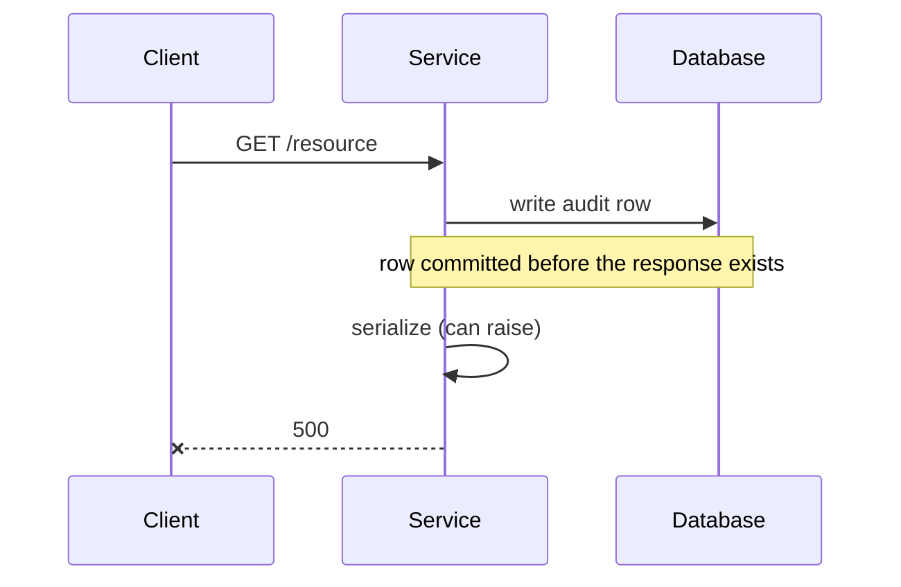

# Mermaid guide

Diagram selection, syntax that survives GitHub's renderer, and before/after
conventions for debrief docs.

## Picking the type

Pick by **what the change is actually about**, not by what looks impressive. One
well-chosen diagram beats three decorative ones.

| The change is mostly about… | Type | Because |
|---|---|---|
| A runtime interaction between components | `sequenceDiagram` | Shows ordering and who calls whom. Ordering bugs are invisible in a flowchart. |
| Branching logic or a pipeline | `flowchart` | Shows the decision points and where a value can escape. |
| Architecture / component relationships | `flowchart` + `subgraph` | Boundaries are the message; subgraphs draw them. |
| Lifecycle or status transitions | `stateDiagram-v2` | Makes illegal transitions visible by their absence. |
| Schema or data model | `erDiagram` | Cardinality is the message and only ER notation carries it. |
| Ownership across teams | `flowchart` + `subgraph` per owner | Blast radius reads off the picture. |

Some changes deserve **no** diagram. A one-file bug fix, a rename, a dependency
bump: skip it. A diagram that restates a sentence is noise.

## Ordering-sensitive changes

If the change moved *when* something happens — record-after-render, commit
ordering, a hook moving between callbacks — use `sequenceDiagram` and draw both
orders. Ordering is the one thing a flowchart genuinely cannot express, and
"before vs after" is the whole explanation.



## Before/after convention

For refactors and architectural changes, a **pair of small diagrams** beats one
large annotated diagram. Readers compare shapes far better than they trace
annotations.

Use two fenced blocks under `### Before` and `### After` headings. Keep both at
the same level of abstraction and the same node names, so the difference is the
only thing that moves. If a node exists in only one of them, that absence is the
finding — do not paper over it by inventing a placeholder.

Do not use `%% comments` to carry meaning. They do not render.

## Syntax constraints that actually bite

GitHub, and most Markdown viewers, render Mermaid from a fenced ` ```mermaid `
block. These are the failures worth knowing before you write:

- **Quote any label containing punctuation.** `A[Retry (max 3)]` breaks;
  `A["Retry (max 3)"]` is fine. Parentheses, colons, commas, `#`, and `<br/>`
  all need the quotes.
- **Node ids must be alphanumeric-ish.** No dots or dashes in the id itself —
  `my.node` breaks. Put the readable name in the label: `myNode["my.node"]`.
- **`end` must be lowercase** to close a `subgraph`. `End` silently breaks the
  parse.
- **No trailing semicolons** are needed; mixed styles inside one diagram are a
  common source of parse errors.
- **`stateDiagram-v2`, not `stateDiagram`** — v1 has meaningfully worse layout
  and different transition syntax.
- **Keep it under ~15 nodes.** Past that, split into two diagrams by concern.
  A wall of boxes conveys less than a paragraph.
- **Direction:** `flowchart TD` for pipelines and decisions, `flowchart LR` for
  layered architecture. Pick one per document and stay with it.

## Verify before shipping it

A broken diagram in a committed doc is worse than no diagram — it signals nobody
read the file. Before writing it into the doc:

1. Re-read the fence for the constraints above, especially unquoted punctuation.
2. Render it in the conversation so the user sees it now.
3. If a renderer is available (`mmdc`, a Mermaid MCP tool, the Artifact tool),
   use it. Otherwise say plainly that the syntax is unverified.
